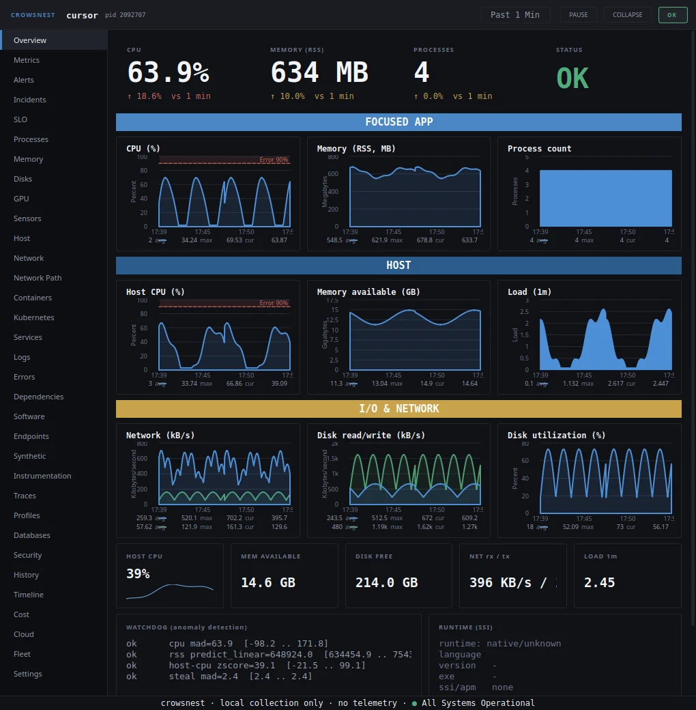
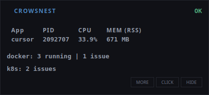
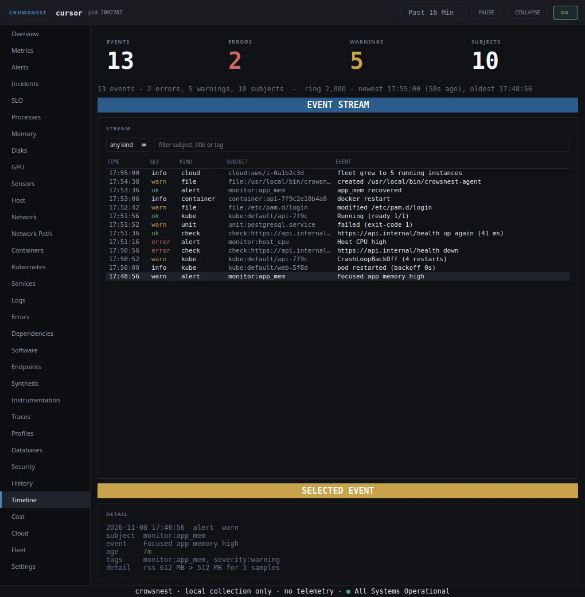
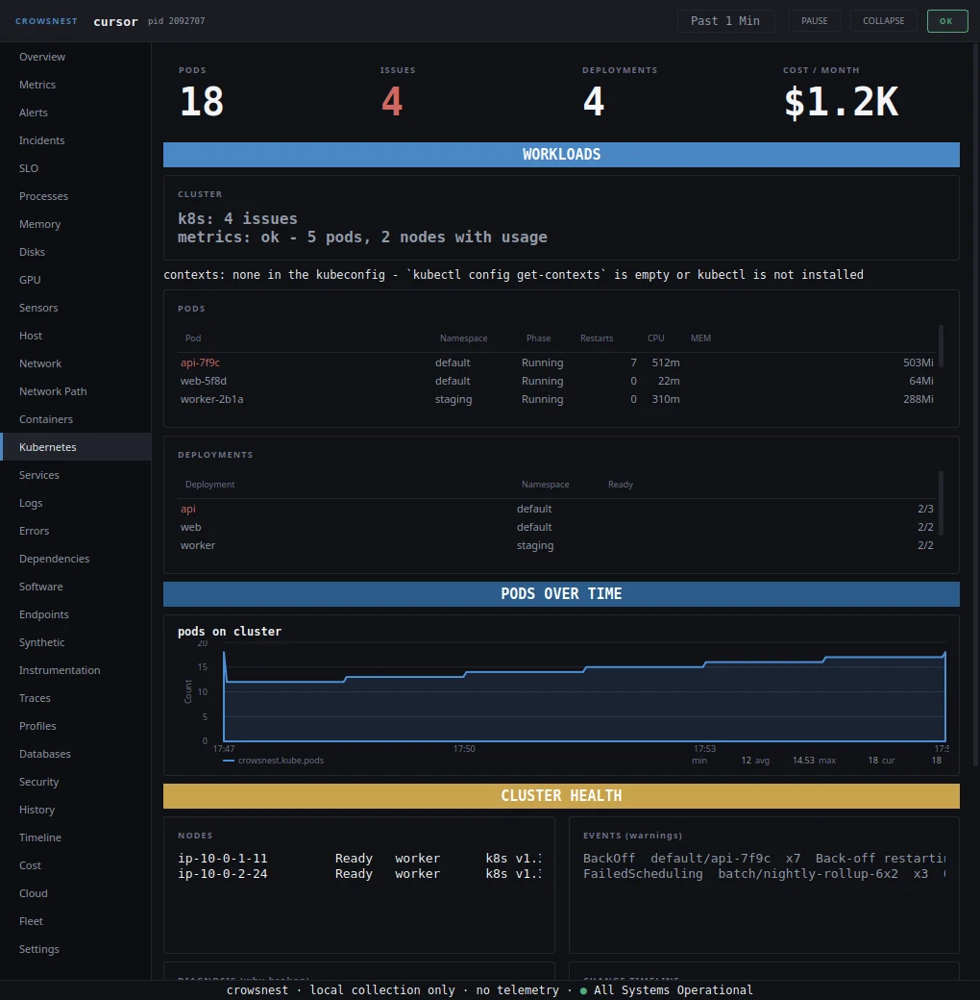
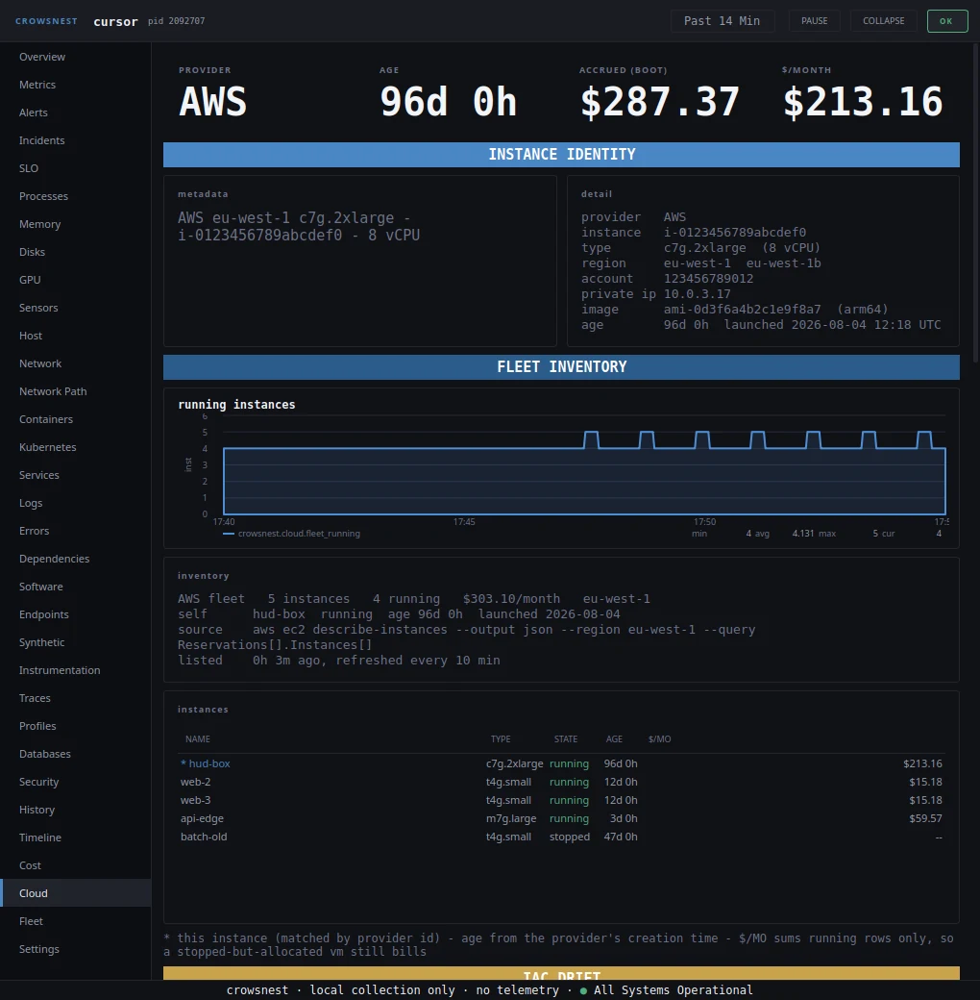

<div align="center">


# Crowsnest

### A local first HUD that follows the app you are using, and a console with 33 views for everything the machine does.

[](https://github.com/codeafridi/Crowsnest/releases)
[](LICENSE)
[](cpp)
[](https://github.com/codeafridi/Crowsnest/stargazers)

<code>curl https://raw.githubusercontent.com/codeafridi/Crowsnest/main/install.sh | sh</code>

[Quickstart](#quickstart) · [Capabilities](#capabilities) · [Tour](#tour) · [Platforms](#platforms) · [Configuration](#configuration) · [FAQ](#faq) · [Documentation](#documentation)



</div>

> [!NOTE]
> Crowsnest reads the machine it runs on. No account, no cloud dependency, no
> telemetry service. The only traffic is what you switch on and can name.

`top` answers "how busy is this box". Crowsnest answers "what is the app I am
using doing, and why did it get slow". It follows the focused window and shows
that app's cost in a strip that stays on top, then opens into a full console:
host, kernel, containers, Kubernetes, logs, traces, cost, cloud and a timeline
that ties a spike to the event that caused it.

The desktop app is free and complete on its own. Shared state across machines
lives in the Crowsnest relay, a separate server that nothing talks to until you
enable it.

## Quickstart

Linux and macOS, in a terminal:

```sh
curl https://raw.githubusercontent.com/codeafridi/Crowsnest/main/install.sh | sh
```

Windows, in PowerShell:

```powershell
irm https://raw.githubusercontent.com/codeafridi/Crowsnest/main/cpp/packaging/windows/install.ps1 | iex
```

The script detects the platform, installs the app and puts `crowsnest` on your
path. Every release also carries a `.deb`, a `.dmg`, an `.msi`, a portable zip
and an AppImage for people who prefer to install by hand.

The first start puts a compact strip on screen. Click it to open the console.

```sh
crowsnest run        start in the foreground
crowsnest start      start in the background
crowsnest status     version, uptime, running instances
crowsnest logs       tail the log
crowsnest update     install the latest release
crowsnest uninstall  remove it
```

On GNOME or KDE, enable the focus bridge once so the HUD can see the active
window. [docs/manual.md](docs/manual.md) has the command for both desktops.
Everything else works without it.

## Capabilities

The console has 33 pages, in rail order: Overview, Metrics, Alerts, Incidents,
SLO, Processes, Memory, Disks, GPU, Sensors, Host, Network, Network Path,
Containers, Kubernetes, Services, Logs, Errors, Dependencies, Software,
Endpoints, Synthetic, Instrumentation, Traces, Profiles, Databases, Security,
History, Timeline, Cost, Cloud, Fleet, Settings.

<table>
<tr><th align="left">Area</th><th align="left">What it shows</th><th align="left">Linux</th><th align="left">macOS</th><th align="left">Windows</th></tr>
<tr><td><b>Focus strip</b></td><td>The app in front with its PID, CPU, memory, threads, file descriptors and context switches, plus the runtime it is written in</td><td>yes</td><td>yes</td><td>yes</td></tr>
<tr><td><b>Overview</b></td><td>Host and app history on one page, with a tick on the chart for every alert, restart and change</td><td>yes</td><td>yes</td><td>yes</td></tr>
<tr><td><b>Processes</b></td><td>Per process CPU, memory, sockets, listening ports, block I/O and the verbs that act on them</td><td>yes</td><td>partial</td><td>partial</td></tr>
<tr><td><b>Kernel depth</b></td><td>Per connection TCP diagnostics, kernel limit pressure, cgroup peaks and OOM counts, PSI, namespaces</td><td>yes</td><td>gated</td><td>partial</td></tr>
<tr><td><b>Containers</b></td><td>Docker state, CPU, memory, network, block I/O and start, stop, restart</td><td>yes</td><td>yes</td><td>yes</td></tr>
<tr><td><b>Kubernetes</b></td><td>Pods, deployments, nodes, pod metrics, cost, deprecated APIs and kubeconfig contexts</td><td>yes</td><td>yes</td><td>yes</td></tr>
<tr><td><b>Services</b></td><td>systemd, launchd or SCM units with their failures, restarts and restart verb</td><td>yes</td><td>yes</td><td>yes</td></tr>
<tr><td><b>Logs and errors</b></td><td>journald, unified log or EventLog with parsed facets, grouping, secret detection and a threat scan</td><td>yes</td><td>yes</td><td>yes</td></tr>
<tr><td><b>Traces</b></td><td>OTLP over HTTP with a service map and per service latency</td><td>yes</td><td>yes</td><td>yes</td></tr>
<tr><td><b>Databases</b></td><td>PostgreSQL cache hit, commits, rollbacks, deadlocks and the slowest statements</td><td>yes</td><td>yes</td><td>yes</td></tr>
<tr><td><b>Hardware</b></td><td>GPU utilization, VRAM and per process GPU use; temperatures, fans, power, battery</td><td>yes</td><td>partial</td><td>partial</td></tr>
<tr><td><b>Security</b></td><td>Sandbox exposure and hardening findings, file integrity, log based threats</td><td>yes</td><td>yes</td><td>yes</td></tr>
<tr><td><b>History and timeline</b></td><td>A bounded ring you can rewind, one stream of every change, CSV and JSON export</td><td>yes</td><td>yes</td><td>yes</td></tr>
<tr><td><b>Cost and cloud</b></td><td>Cluster cost model and right sizing, cloud identity, billed spend, account inventory</td><td>yes</td><td>yes</td><td>yes</td></tr>
<tr><td><b>Fleet</b></td><td>Several machines polling each other, shown in one console</td><td>yes</td><td>yes</td><td>yes</td></tr>
</table>

Live means the card is real on that platform. Partial means some collectors or
verbs are replaced by the closest honest analogue. Gated means the OS exposes no
unprivileged equivalent, and the card says so instead of showing an empty box.
[docs/macos.md](docs/macos.md) and [docs/windows.md](docs/windows.md) list every
card and every gate.

## Tour



**The strip is the front door.** It names the app you are in, what it costs and
whether containers or Kubernetes need attention, and it never takes focus. One
click opens the console at the last place you left it.



**The timeline answers "why did this spike".** Alerts, restarts, container
changes, file changes and Kubernetes events land in one stream. Click an event
and the console narrows to that instant. Charts carry the same events as ticks,
so the spike and its cause are read together.



**Kubernetes without a second agent.** Pods, deployments, nodes, pod metrics,
deprecated APIs and a cost model read through the kubectl you already have.
Problem pods and their events are surfaced before the whole page.



**The box itself, priced.** Instance identity comes from the local metadata
service, rates from a file you import, spend from the provider CLI you already
logged in to. The card states where each number came from.

## Platforms

Linux is the primary target and every view is live there. macOS and Windows are
beta with native collectors: host, processes, sockets, disk I/O, services, logs,
security posture and the console work, while the surfaces their kernel does not
expose are replaced or gated.

<table>
<tr><th align="left">Distribution</th><th align="left">Distribution package</th><th align="left">Portable bundle</th><th align="left">Note</th></tr>
<tr><td>Ubuntu 24.04 and 26.04</td><td>yes</td><td>yes</td><td></td></tr>
<tr><td>Ubuntu 22.04</td><td>yes</td><td>yes</td><td>also install libgl</td></tr>
<tr><td>Debian 12 and 13</td><td>yes</td><td>yes</td><td></td></tr>
<tr><td>Fedora 42 and 44</td><td>yes</td><td>yes</td><td></td></tr>
<tr><td>RHEL 9, Rocky 9, Alma 9</td><td>yes</td><td>yes</td><td>Qt 6 from EPEL</td></tr>
<tr><td>Arch, Manjaro, CachyOS</td><td>yes</td><td>yes</td><td></td></tr>
<tr><td>openSUSE Tumbleweed</td><td>yes</td><td>yes</td><td></td></tr>
<tr><td>Alpine</td><td>yes</td><td>no</td><td>musl build from source</td></tr>
</table>

The portable bundle needs glibc 2.34 or newer on 64 bit x86. macOS 12 or newer
is supported, and Windows 10 and 11. Every release is built and tested on the
three platform runners and installed from scratch in clean containers, not only
on the machine it was written on.

## Configuration

Settings live in `config.ini` under the platform config directory, with
`~/.config/crowsnest/config.ini` on Linux. Everything has a working default, so
the app runs with no file at all. The surfaces worth knowing:

```ini
[metrics]
enabled = true
port = 9107
token = a shared secret, or empty for loopback only

[webhook]
enabled = false
url = https://your.receiver/hook

[remote]
enabled = false
url = https://relay.example.com
token = your ingest token
```

`[cloud]` turns the metadata read and the provider CLI on or off, `[fleet]`
carries peers, `[overlay]` the strip position, `[alerts]` the monitor thresholds
and `[theme]` the accent and backdrop. The full key list is in
[docs/manual.md](docs/manual.md).

## FAQ

<details>
<summary><strong>Does it need root?</strong></summary>

No. Crowsnest reads what your user is allowed to read and says so when a surface
is out of reach, such as another user's sockets. A couple of surfaces can use
`sudo crowsnest` for more detail.
</details>

<details>
<summary><strong>Does it send anything anywhere?</strong></summary>

Nothing goes to us. The optional calls are ones you configure: the local
Prometheus endpoint, an alert webhook, the relay reporter, and the cloud CLI and
metadata read that the Cloud page documents and can switch off.
</details>

<details>
<summary><strong>What does the paid relay add?</strong></summary>

Shared state that outlives a closed laptop: fleet history, rules, paging,
on call rotas, members and billing. The desktop app is free and not gated, and
the reporter is off until you enable it. See [docs/remote.md](docs/remote.md).
</details>

<details>
<summary><strong>Which Qt and compiler does it need?</strong></summary>

Qt 6.2 or newer, C++20 and CMake 3.16. The portable bundle and the packages ship
their own Qt, so a stock desktop needs no toolchain.
</details>

<details>
<summary><strong>Uninstall?</strong></summary>

`crowsnest uninstall` removes the binary, the launcher, the service unit and the
autostart entry. Your config and cache stay, so a reinstall picks up where you
left off.
</details>

## Documentation

* [docs/manual.md](docs/manual.md): install variants, compatibility, advanced configuration, troubleshooting
* [docs/macos.md](docs/macos.md) and [docs/windows.md](docs/windows.md): per platform notes and feature matrices
* [docs/cloud.md](docs/cloud.md): cloud identity, rates and billed spend
* [docs/fleet.md](docs/fleet.md): several machines in one console
* [docs/remote.md](docs/remote.md): the relay reporter and its privacy rules
* [docs/build.md](docs/build.md): build from source and the package gate

## Contributing

Issues and pull requests are welcome. [CONTRIBUTING.md](CONTRIBUTING.md) covers
the build, the tests and the review expectations. Report security problems
through [SECURITY.md](SECURITY.md).

## License

MIT. See [LICENSE](LICENSE).
