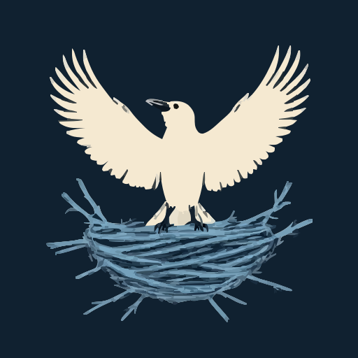
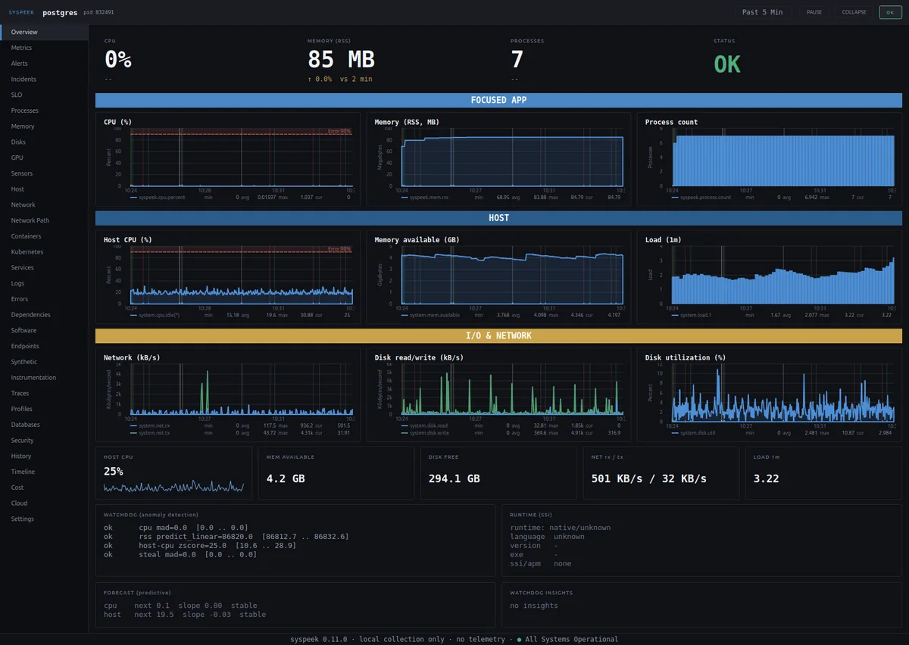

<div align="center">



# Crowsnest

A local first HUD that follows the app you are using, and a 33 view console for
everything your machine is doing.



</div>

Crowsnest runs on the machine it measures. It follows the focused window, shows
that app's cost in an always on top strip, and keeps a full metrics console
behind it. Collection is local and unprivileged, with no account and no telemetry
service. The optional cloud and fleet surfaces talk only to the provider CLI and
the peers you point them at.

## What you get

* **Focus tracking.** The strip names the app you are in with its PID, CPU,
  memory, threads, file descriptors and context switches, plus the runtime it is
  written in. It never steals focus.
* **A 33 view console.** Overview, Metrics, Alerts, Incidents, SLO, Processes,
  Memory, Disks, GPU, Sensors, Host, Network, Network Path, Containers,
  Kubernetes, Services, Logs, Errors, Dependencies, Software, Endpoints,
  Synthetic, Instrumentation, Traces, Profiles, Databases, Security, History,
  Timeline, Cost, Cloud, Fleet, Settings.
* **Alerts and incidents.** Local thresholds on CPU, memory, file descriptors,
  CPU steal, failed services and journal errors. Acknowledge and close, silence
  a rule, and read one ordered timeline. Desktop popups are deliberately absent.
  Point the optional webhook at your own pager if you want one.
* **Linux depth.** Per connection TCP diagnostics through netlink, kernel limit
  pressure, cgroup memory peaks and OOM counts, PSI, per process and per
  container block I/O, and a cgroup view of the focused app's unit.
* **Integrations, all optional and local.** Docker through its socket,
  Kubernetes through kubectl, PostgreSQL statistics, OTLP traces, DogStatsD
  metrics, synthetic HTTP checks, TLS expiry, and a Prometheus endpoint bound to
  loopback.
* **Machines and cloud.** A peer fleet view, cloud identity and billed spend
  through the provider CLI you already use, a bounded history ring you can
  rewind, and CSV or JSON export.

## Install

Linux and macOS, in a terminal:

```sh
curl https://raw.githubusercontent.com/codeafridi/Crowsnest/main/install.sh | sh
```

Windows, in PowerShell:

```powershell
irm https://raw.githubusercontent.com/codeafridi/Crowsnest/main/cpp/packaging/windows/install.ps1 | iex
```

The script detects the platform, installs the app and adds the `crowsnest`
command. Packages are attached to every release: `.deb`, `.dmg`, `.msi`, a
portable zip and an AppImage. No curl? The manual lists the wget fallback.

On GNOME or KDE, enable the focus bridge once so the HUD can see the active
window. The manual has the command for both desktops, and everything else works
without it.

## Run it

The first start puts a compact strip on screen. Click it to open the console.

```sh
crowsnest run        start in the foreground
crowsnest start      start in the background
crowsnest status     version, uptime, running instances
crowsnest logs       tail the log
crowsnest update     install the latest release
crowsnest uninstall  remove it
```

Settings in the console hold the rest: appearance, collection, alert thresholds,
the optional endpoints and the diagnostics.

## Platforms

Linux is the primary target and every view is live there. macOS and Windows are
beta: host, processes, network, containers, the console and the focus strip
work, while the kernel level surfaces are replaced or gated where the OS has no
honest equivalent. A gated card names the reason instead of showing an empty
box. Notes are in [docs/macos.md](docs/macos.md) and
[docs/windows.md](docs/windows.md).

## Shared state for more than one machine

Fleet mode lets Crowsnest instances poll each other over a local endpoint
guarded by a shared token, so one console can show several machines. Shared
history, paging and on call rotas live in the Crowsnest relay, which is a
separate server. Nothing is sent to it until you enable `[remote]`. See [docs/fleet.md](docs/fleet.md)
and [docs/remote.md](docs/remote.md).

## Build

Qt 6.2 or newer, C++20, CMake 3.16. The distro package commands, the build
steps and the clean room package gate are in [docs/build.md](docs/build.md).

## Documentation

* [docs/manual.md](docs/manual.md): the full manual, every install variant,
  compatibility, advanced configuration and troubleshooting
* [docs/cloud.md](docs/cloud.md): cloud identity, rates and billed spend
* [docs/fleet.md](docs/fleet.md): several machines in one console
* [docs/remote.md](docs/remote.md): the relay reporter and its privacy rules


## License

MIT. See [LICENSE](LICENSE).
